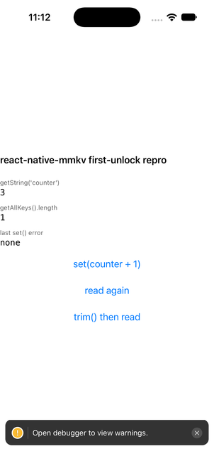
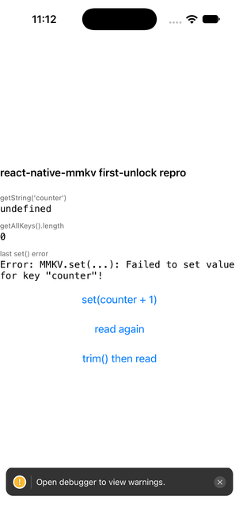
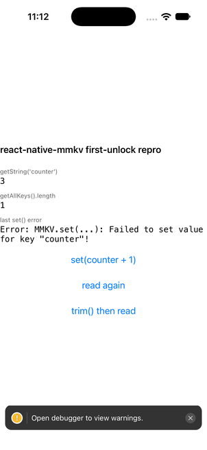

# react-native-mmkv: a background launch before the first unlock leaves every instance dead

Minimal repro for an iOS failure mode in `react-native-mmkv` (4.3.2, MMKVCore 2.4.x):

1. iOS launches the app in the background after a reboot, before the user has unlocked the phone
   once (a Live Activity alive at reboot does this, Apple bug FB14562763; a `content-available`
   push can too).
2. MMKV's files use `NSFileProtectionCompleteUntilFirstUserAuthentication` (MMKVCore forces that
   class in `tryResetFileProtection`), so `open()` fails with `EPERM`.
3. `createMMKV()` still returns an instance. Every read returns `undefined`, every `set()` throws
   `MMKV.set(...): Failed to set value for key "counter"!`.
4. MMKVCore loads a file once per process (`m_needLoadFromFile` is cleared after the first attempt),
   so the instance never recovers after the unlock. The process stays "signed out" until it is killed.

The app cannot tell this apart from empty storage, so persisted stores hydrate with defaults.

## Run

```bash
npm install
npx expo run:ios            # any iOS simulator; react-native-mmkv needs a native build
```

Tap **set(counter + 1)** a few times. The counter persists across relaunches.

## Reproduce the dead instance

The simulator has no lock screen, so `chmod 000` stands in for data protection. Both make
`open()` fail and take the same MMKV code path (`EACCES` on the simulator, `EPERM` on a device).

```bash
UDID=<booted simulator udid>
./scripts/lock-storage.sh $UDID                        # terminate + chmod 000 Documents/mmkv/*
xcrun simctl launch $UDID com.example.mmkvfirstunlockrepro
```

Observed on the cold start:

- `getString('counter')` → `undefined`, `getAllKeys().length` → `0`
- **set(counter + 1)** → `Error: Failed to set value for key "counter"!`

Now "unlock" without restarting the app, as a real unlock does not restart it either:

```bash
./scripts/unlock-storage.sh $UDID                      # chmod 600, app keeps running
```

- **read again** → still `undefined`. The instance never retries the open.
- **trim() then read** → the counter is back. `trim()` happens to call `MMKV::clearMemoryCache()`,
  which re-arms `loadFromFile()`; nothing in the public API is documented to do this.

## Real device

Start any Live Activity from the app, reboot the phone, do not unlock, wait a minute, then unlock
and open the app. The console shows MMKV's
`fail to open [...] 1(Operation not permitted)` followed by `file [...] not valid`.

## Screenshots (iOS 27 simulator, react-native-mmkv 4.3.2, Expo SDK 58)

| persisted | locked cold start | unlocked, read again | after trim() |
|---|---|---|---|
|  |  |  |  |
